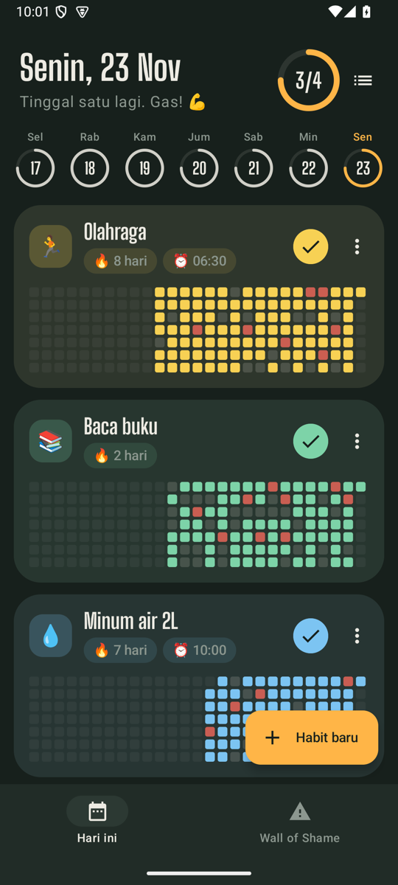
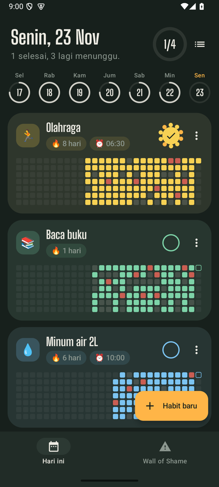
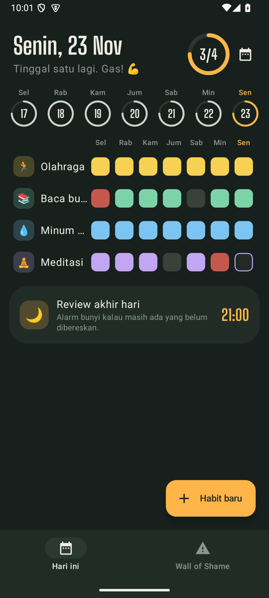
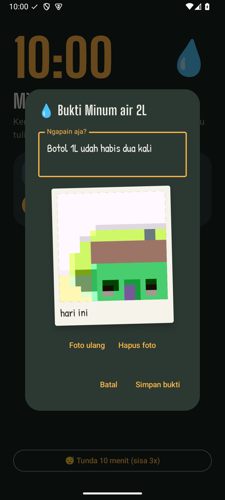
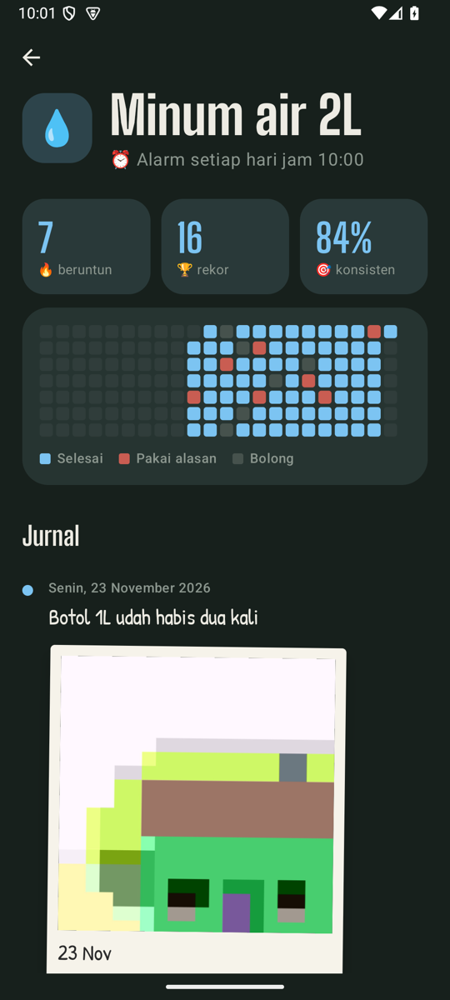
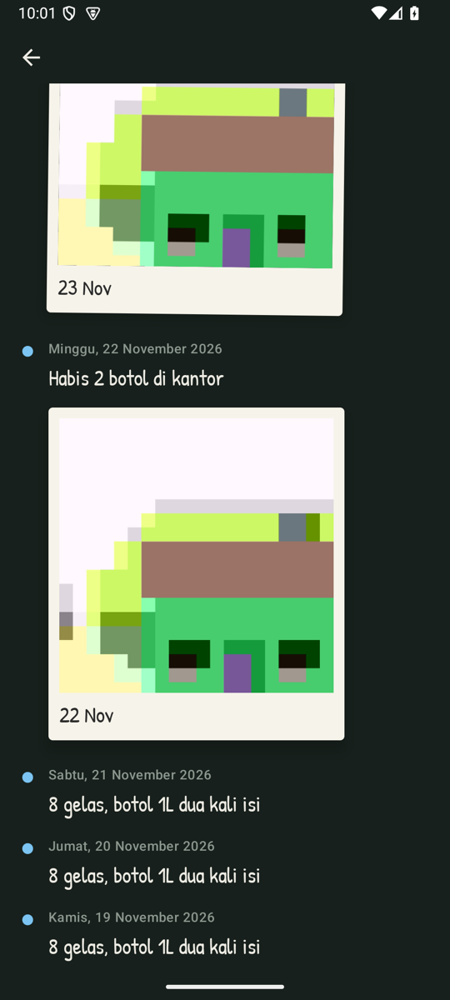
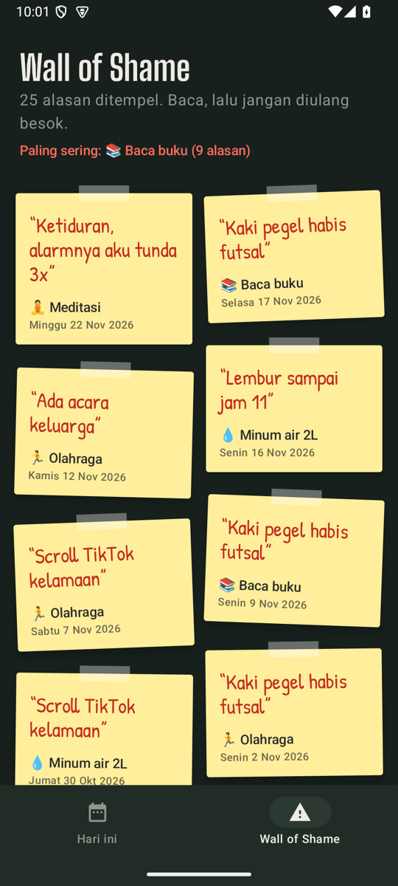
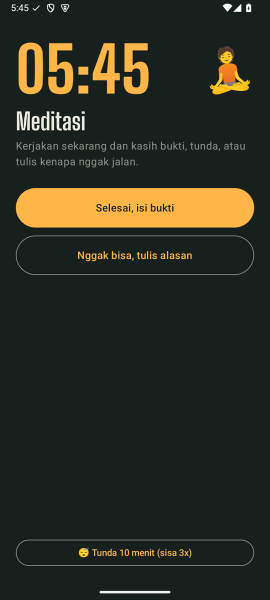
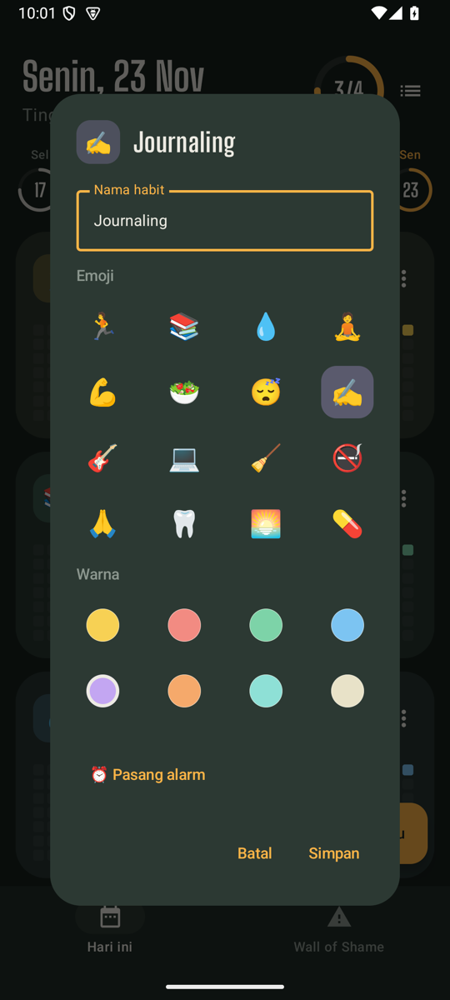

# Tickit

An Android habit tracker you can't ignore. Reminders ring like a real alarm, every tick needs proof (a note and optionally a photo), and when you skip a day you have to write down why. Those reasons go up on the **Wall of Shame**.

Inspired by the TickOff habit tracker, rebuilt with Kotlin and Jetpack Compose using MVVM and clean architecture. The app's UI is in Indonesian.

## Screenshots

| Today | Tick lands (chalk burst) | Compact, last 7 days |
|:---:|:---:|:---:|
|  |  |  |
| **Proof with a polaroid** | **Habit detail** | **Proof journal** |
|  |  |  |
| **Wall of Shame** | **Alarm** | **New habit** |
|  |  |  |

The screenshots use sample data.

## Features

- **Today at a glance.** A progress ring shows how many habits are done today, a line of copy tells you where you stand ("Tinggal satu lagi. Gas!"), and a strip of seven rings shows how the past week went.
- **Habits with personality.** Each habit has an emoji and a chalk colour, picked when you create it. Cards are tinted in the habit's colour.
- **GitHub-style progress tiles.** Each habit gets a contribution grid: one column per week, Monday at the top, the current week on the right. A tile in the habit's colour means done, red means skipped with a reason, dark means missed. Today is outlined until you deal with it.
- **Two layouts.** Tiles show months of history; compact shows every habit across the last seven days. Switch with the icon in the top right.
- **Every tick needs proof.** A note on what you did is required; a camera photo is optional and shows up as a polaroid. When the tick is saved, the check button pops and throws a small burst of chalk (with a haptic tap). Undoing a tick deletes its note and photo, after a confirmation.
- **Habit detail.** Current streak, longest streak, consistency since the habit was created, a large tile grid with a legend, and a journal timeline of every proof (handwritten note plus polaroid) and excuse, newest first.
- **Reminders are alarms.** Looping alarm sound, vibration, screen wake-up, and a full-screen alarm over the lock screen with a big clock and the habit's emoji wiggling until you act. If the phone is in use, it shows as a heads-up notification instead.
- **Snooze.** 10 minutes, at most 3 times. After that the only options are proof or a reason.
- **No progress means a reason.** Reasons are pinned to the Wall of Shame as yellow sticky notes in red pen, along with the habit you excuse most often. Deleting a habit doesn't remove them.
- **End-of-day review.** An alarm at a time you choose (default 21:00) listing whatever is still open. It only rings if something is.
- **Alarms that survive.** Habits already dealt with stay quiet. Alarms are rescheduled after a reboot, a clock or time zone change, an app update, or a permission change.

## Proof photos: why not Firebase

Since 3 February 2026, [Cloud Storage for Firebase](https://firebase.google.com/docs/storage/faqs-storage-changes-announced-sept-2024) requires the **Blaze** pay-as-you-go plan, which means attaching a billing account. A no-cost quota still exists on Blaze, but the free Spark plan has no Storage access at all.

Tickit is fully offline, so photos are kept in the **app's private storage on the phone**. That's free and needs no account. The trade-offs:

- Photos are shrunk automatically to about 1600 px on the long edge at JPEG quality 82. A 3–5 MB camera shot becomes roughly 200–400 KB, and the EXIF rotation is kept.
- Photos are **excluded from Android backup**, because Auto Backup stops at 25 MB and photos would push the database out. Habits, notes and reasons are still backed up. Photos are lost if you uninstall the app or move to a new phone.

## Design

The concept is a **blackboard**, playful but tidy: a slate background, chalk-coloured text, a pastel chalk colour and an emoji per habit, and red pen for excuses. Things you wrote yourself are pinned to the board as paper: excuses on yellow sticky notes held by a strip of tape, proof photos as tilted polaroids.

| Token | Hex | Used for |
|---|---|---|
| Board | `#17201C` | background |
| Slate | `#212C27` | cards, dialogs, navigation |
| Chalk | `#EDEBE3` | primary text |
| Dust | `#8C978F` | secondary text |
| Alarm | `#FFB547` | primary actions, progress, alarm clock |
| Red pen | `#FF6B5E` | excuses on the board |
| Sticky note | `#FFEE9C` + ink `#C42E20` | Wall of Shame notes |
| Polaroid | `#F6F3EA` | proof photo frames |

Type has three roles:

- **Big Shoulders Display**, a condensed scoreboard face: dates, habit names, numbers, the alarm clock.
- **Patrick Hand**, handwriting: only for words you wrote (proof notes and excuses), so your own voice is easy to spot.
- The system's Roboto: everything else.

Both fonts are licensed under SIL OFL 1.1, see [`licenses/`](licenses/).

Motion answers what you do: rings fill when progress changes, and a tick pops and bursts. The only motion that runs on its own is the wiggling emoji on the alarm screen, whose job is to grab attention.

## Spec

| | |
|---|---|
| Language / UI | Kotlin 2.2, Jetpack Compose, Material 3 (custom dark theme) |
| Architecture | MVVM + clean architecture (domain / data / presentation), one `UiState` per screen, manual DI |
| Storage | Room 2.7 (SQLite, schema v2 with a 1→2 migration), SharedPreferences for settings, private files for photos |
| Images | Coil 3 (`AsyncImage`) |
| Alarms | `AlarmManager.setAlarmClock` (exact, Doze-proof), `CATEGORY_ALARM` notification with `FLAG_INSISTENT` and a full-screen intent |
| Camera | `ActivityResultContracts.TakePicture` + `FileProvider`, no `CAMERA` permission |
| Min / target SDK | 27 (Android 8.1) / 35 (Android 15) |
| Build | AGP 8.11, Gradle 8.14 (wrapper), JDK 17+ (tested on JDK 21) |
| Application ID | `io.github.firmanains.tickit` |

### Layout

```
app/src/main/java/io/github/firmanains/tickit/
├── domain/                 # pure Kotlin, no Android
│   ├── model/              # Habit, CheckIn, Proof, HabitToday, HabitDetail, DayStatus, ShameEntry
│   ├── repository/         # HabitRepository, SettingsRepository, PhotoStore, ReminderScheduler interfaces
│   ├── usecase/            # ObserveToday, ObserveHabitDetail, AddHabit, DeleteHabit, CompleteHabit,
│   │                       # UndoCheckIn, Excuse, Snooze, RescheduleAll, SetEndOfDay
│   └── Schedule.kt         # nextTrigger, streak, weekColumns, dayStatus, dayProgress, stats, AlarmPolicy
├── data/
│   ├── local/              # Room entities, DAO, database, migrations
│   ├── photo/              # LocalPhotoStore: new path, shrink, delete
│   └── repository/         # RoomHabitRepository (also cleans up replaced photos), PrefsSettingsRepository
├── alarm/                  # platform side: scheduler, notifier, receivers, PendingIntents
├── di/AppContainer.kt      # dependency wiring + ViewModel factories
└── presentation/
    ├── home/               # Today: progress ring, week strip, habit cards / compact grid, permission banners
    ├── habit/              # detail: stats, large tiles, journal timeline
    ├── shame/              # Wall of Shame sticky notes
    ├── alarm/              # AlarmActivity (full-screen)
    ├── common/             # TileGrid, Playful (EmojiBadge, ProgressRing, Polaroid), dialogs
    └── Theme.kt            # colour and paper tokens, emojis, typography
```

Dependencies point `presentation → domain ← data / alarm`. The domain layer knows nothing about Android.

### Alarm flow

```
AlarmManager.setAlarmClock ──► AlarmReceiver (RING)
                                 ├─ schedule tomorrow's alarm
                                 ├─ already dealt with? → stay quiet
                                 └─ still open → alarm notification (looping, full-screen intent)
                                              │
                                 AlarmActivity / notification buttons
                                  ├─ Done, add proof → note (+ photo) → alarm stops
                                  ├─ Can't do it     → reason → Wall of Shame → alarm stops
                                  └─ Snooze          → RING_AGAIN in 10 min (max 3x)
```

Left alone, an alarm goes quiet after 10 minutes. The habit still shows up in the end-of-day review.

### Data

- `habits(id, name, emoji, reminderMinute?, colorIndex, createdEpochDay, archived)`: deleting is a soft delete (`archived = 1`). Schema v2 added `emoji`; the migration gives existing habits ✨.
- `check_ins(habitId, epochDay, done, reason?, note?, photoPath?)`: one row per habit per day. `done = 1` holds the proof (`note`, `photoPath`); `done = 0` holds the `reason` and appears on the Wall of Shame.

## Build and install

```bash
# needs the Android SDK (platform 35) and JDK 17+
echo "sdk.dir=$HOME/Library/Android/sdk" > local.properties
./gradlew testDebugUnitTest assembleDebug

# phone with USB debugging enabled
adb install -r app/build/outputs/apk/debug/app-debug.apk
```

### Permissions

| Permission | Android 13 | Android 14+ |
|---|---|---|
| Notifications | requested from a banner on the home screen | same |
| Exact alarms | granted automatically | must be allowed manually (banner → Settings) |
| Full-screen alarms | granted automatically | must be allowed manually (banner → Settings) |

The camera needs no permission: the system camera app takes the photo and writes it straight into Tickit's private storage.

**Xiaomi / Redmi / POCO (MIUI/HyperOS)** and other phones with aggressive battery management: open the app info and turn on **Autostart**, set **Battery saver → No restrictions**, and enable **Show on lock screen** and **Display pop-up windows while running in background**.

## Tests

- Unit tests (`./gradlew testDebugUnitTest`): next alarm time, streaks, weekly tile layout, per-day status, daily progress for the week strip, stats (longest streak, consistency), and the rule that a tick needs a note.
- Checked by hand on an Android 15 emulator: upgrading a schema v1 database with 4 habits and 281 check-ins to v2 without losing data, tiles and compact layout, the tick burst, ticking with a camera photo, polaroids in the journal, sticky notes on the Wall of Shame, the single-habit and end-of-day alarms from a locked screen, and adding proof from the alarm screen until the alarm stops.

## For AI agents

[`AGENTS.md`](AGENTS.md) describes this project's conventions for AI coding agents: the architecture, the deliberate choices, and how to verify changes. The Android skills come from [awesome-android-agent-skills](https://github.com/new-silvermoon/awesome-android-agent-skills), plus the `frontend-design` skill for visual direction. Skills and MCP config live locally in `.claude/` and aren't committed, because they contain machine-specific paths.

## Not built yet

- Editing a habit (for now: delete and add it again)
- Per-weekday schedules (every habit is daily)
- Adding proof for a past day
- Missed days without a tick or reason aren't added to the Wall of Shame automatically
- Cloud sync or backup for photos
- UI text is hardcoded in Indonesian (no `strings.xml` yet)
